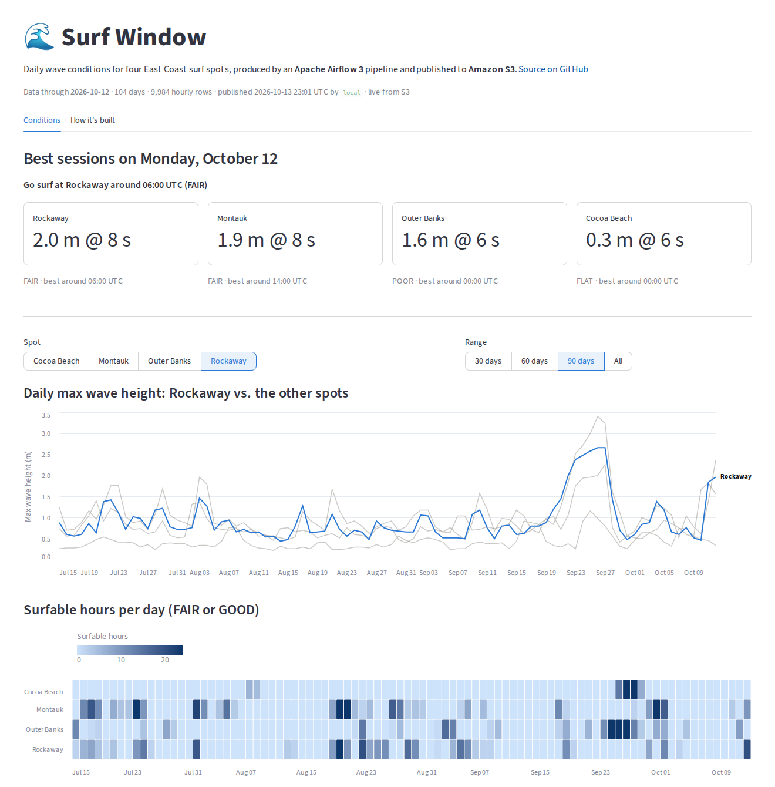
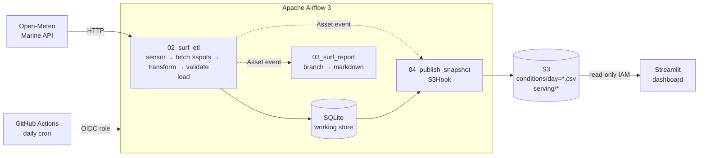

# 🌊 Surf Window: an Apache Airflow 3 data pipeline

[](https://github.com/vladimir-kazarin/airflow-surf-pipeline/actions/workflows/ci.yml)
[](https://github.com/vladimir-kazarin/airflow-surf-pipeline/actions/workflows/daily-pipeline.yml)
[](https://airflow-surf-pipeline.streamlit.app)

A daily pipeline that pulls hourly ocean-wave data for four East Coast surf spots, rates
every hour for surfability, validates it, stores it in S3 as one partition per day, and
serves it on a live Streamlit dashboard.

**[Live dashboard →](https://airflow-surf-pipeline.streamlit.app)**



## What this project demonstrates

| Area | How |
|---|---|
| **Orchestration (Airflow 3.3)** | TaskFlow DAGs, HTTP sensor (reschedule mode), dynamic task mapping (one task per spot), retries with exponential backoff, branching + trigger rules |
| **Data-aware scheduling** | The ETL emits an **Asset** event with the processed day in its `extra`; a report DAG and a publish DAG both consume it, with no cron coupling |
| **Correct time semantics** | Explicit `CronDataIntervalTimetable`, `logical_date`-driven processing, a guard against incomplete days. Backfills are reproducible. |
| **Data quality** | A validation gate fails the run *before* bad data is loaded (row counts, missing values, plausibility) |
| **Idempotency** | Primary-key upserts locally; one S3 object per day, so re-processing a day overwrites exactly that object. The daily job re-runs the last 3 days, so missed days self-heal. |
| **Cloud + security** | S3 (private, versioned, encrypted). GitHub Actions authenticates with **OIDC** (no stored AWS keys) to a role usable only from `main`. The dashboard uses a read-only key scoped to `serving/*`. |
| **Infrastructure as code** | Terraform for the bucket, OIDC role and dashboard user |
| **Testing & CI** | 37 tests: pipeline logic, DAG integrity (DagBag), dashboard transforms, and a headless Streamlit `AppTest` smoke test. Terraform fmt/validate in CI. |

## Architecture



**In production** a scheduled GitHub Actions workflow installs Airflow, runs the real DAGs
with `airflow dags test` for the last 3 days, and publishes to S3. No server costs: the
only AWS bill is a few cents of S3. **Locally** the same DAGs run under the full Airflow
scheduler and UI (`./scripts/start.sh`).

### S3 layout

```
s3://airflow-surf-pipeline-<account>/
  conditions/day=2026-10-12.csv     one object per day (written by 04_publish_snapshot)
  serving/surf_conditions.csv       compacted history (what the dashboard reads)
  serving/meta.json                 freshness + provenance (run id, source, date range)
  serving/pipeline_runs.csv         one row per publish, shown on the dashboard
```

## Engineering notes

Things I ran into while building this, and how they were resolved:

- **Airflow 3 changed what `@daily` means.** Cron strings now use `CronTriggerTimetable`:
  the logical date is the moment the run fires, so the first scheduled run fetched *today's
  incomplete* data. The DAG now declares `CronDataIntervalTimetable` explicitly, and a guard
  fails fast (`AirflowFailException`, no pointless retries) on incomplete days.
- **Manual runs infer a different interval.** `airflow dags test DAG 2026-10-10` gets a data
  interval *ending* on Oct 10. Keying off `logical_date` makes manual, scheduled and backfill
  runs agree. This matters because production runs through `dags test`.
- **SQLite's single writer.** Creating a 100-day backfill while the scheduler was running
  hit `database is locked`. That's fine for local dev (create the backfill with the
  scheduler stopped), and it's why real deployments use Postgres.
- **Never break the demo.** If S3 is unreachable or credentials are missing, the dashboard
  falls back to a bundled snapshot and says so.

## Repository layout

```
dags/                  Airflow DAGs (01–04) + surf_lib/ (pure, unit-tested logic)
app/                   Streamlit dashboard: own requirements.txt + tests
infra/                 Terraform: S3 bucket, GitHub OIDC role, dashboard reader
.github/workflows/     ci.yml (tests) · daily-pipeline.yml (production run)
tests/                 pipeline + DAG integrity tests
docs/LEARNING.md       Airflow learning guide built around this repo (lessons + exercises)
env.sh                 all Airflow config via environment variables
```

## Run it locally

```bash
./scripts/setup.sh            # venv + Airflow 3.3.2 pinned with official constraints
./scripts/start.sh            # scheduler + UI at http://localhost:8081
source env.sh && pytest tests # pipeline tests
```

Dashboard (offline against the bundled snapshot):

```bash
uv venv .venv-app && uv pip install --python .venv-app/bin/python -r app/requirements.txt
SURF_DATA_DIR=app/sample .venv-app/bin/streamlit run app/streamlit_app.py
```

New to Airflow? **[docs/LEARNING.md](docs/LEARNING.md)** walks through the DAGs as four lessons
with exercises.

## Deploy your own

1. `cd infra && terraform apply -var github_repo=<you>/<repo>`. If your AWS account has no
   GitHub OIDC provider yet, add `-var create_github_oidc_provider=true`.
2. GitHub repo variables: `AWS_ROLE_ARN` (output `github_publisher_role_arn`) and
   `SURF_BUCKET` (output `bucket_name`).
3. Seed history: run the **Daily pipeline** workflow manually with `days: 90`.
4. On [share.streamlit.io](https://share.streamlit.io): entrypoint `app/streamlit_app.py`,
   Python 3.12, and secrets:
   ```toml
   [aws]
   bucket = "<bucket_name>"
   region = "us-east-1"
   access_key_id = "<dashboard_access_key_id>"
   secret_access_key = "<terraform output -raw dashboard_secret_access_key>"
   ```

Data: [Open-Meteo Marine Weather API](https://open-meteo.com/en/docs/marine-weather-api) (CC BY 4.0).
